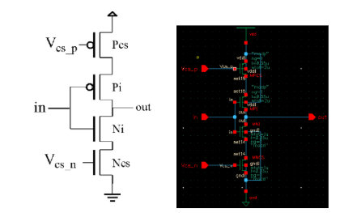
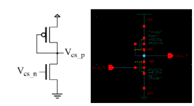
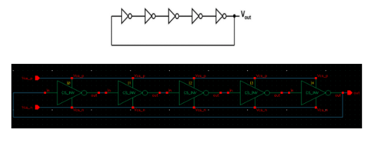
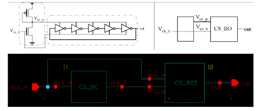
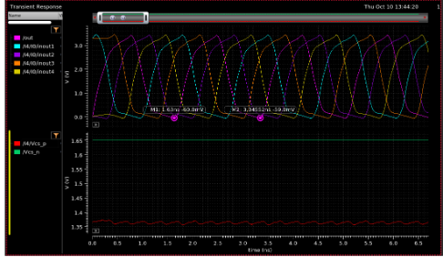

# CMOS Analog & RF IC Design Labs

Analog and RF integrated-circuit design in **Cadence Virtuoso** on the **AMS 0.35 µm CMOS** process: from transistor characterization to a full RF low-noise amplifier, including layout, parasitic extraction and statistical (Monte-Carlo) verification.

Microelectronic Design (DMIC) course, ETSETB–UPC, 2024/25. Labs 3 and 4 were done in a pair with Marc Maldonado; other versions of the reports were done with Arnau Llopart.

## Highlights

| Project | What I designed | Key results |
|---|---|---|
| [RF low-noise amplifier](#1-rf-low-noise-amplifier-184-ghz) | Inductively degenerated cascode LNA for GSM-1800 | 31.2 dB gain · S11 = −38.6 dB · NF = 2.63 dB |
| [Differential amplifier & OpAmp](#2-differential-amplifier-and-simple-opamp) | Fully-differential stage, Monte-Carlo analysis, common-centroid layout | THD 1.6 % vs 10.2 % single-ended · CMRR 67 dB · OpAmp gain 87 |
| [Voltage-controlled oscillator](#3-voltage-controlled-ring-oscillator) | Current-starved 5-stage ring VCO, schematic to post-layout | ~50–900 MHz tuning range · DRC/LVS clean |
| [Amplifier & device fundamentals](#4-fundamentals) | MOSFET characterization, CMOS inverter, common-source amplifier | Gain improved from 7.1 to 10.4 by resizing |

---

## 1. RF low-noise amplifier (1.84 GHz)

A narrowband LNA for the GSM-1800 band, designed to match a 50 Ω antenna and amplify the signal while adding as little noise as possible.

**What I did**
- Biased the input transistor to the target transconductance (30.5 mS) by sweeping its gate voltage, then replaced the ideal bias with a current mirror and re-tuned the reference current to reproduce the same operating point.
- Tuned the source and gate inductors and the added capacitances until the input impedance hit 50 Ω at 1.84 GHz (49.5 Ω real, ≈0 Ω imaginary), and tuned the drain inductor to centre the output resonance on the same frequency.
- Checked the hand-calculated gain against simulation: including the inductors' finite Q, theory predicts 29.6 dB versus 31.3 dB simulated.
- Characterized matching with S-parameters and analysed noise source by source.

**Results**

| Metric | Value |
|---|---|
| Voltage gain at 1.84 GHz | 36.4 V/V (31.2 dB) |
| Input match (S11) at 1.84 GHz | −38.6 dB |
| Matched band (S11 < −10 dB) | 1.58 – 2.21 GHz |
| Noise figure | 2.63 dB |
| Output SNR for a −70 dBm input (200 kHz channel) | 31.3 dB |

The noise summary showed that, after the antenna itself, the gate inductor (21 %) and the input transistor (16 %) dominate the output noise, which points to where a next iteration should improve.

## 2. Differential amplifier and simple OpAmp

**What I did**
- Designed a fully-differential common-source stage and improved its gain from 7.7 to 10.8 by doubling the input transistors' width, keeping the same current and bandwidth (≈4.5 MHz).
- Compared linearity against the single-ended version with the same gain and a 150 mV input.
- Ran **Monte-Carlo** simulations (100 samples) for mismatch and process variations, on both the differential gain and the common-mode rejection.
- Analysed a simple OpAmp (differential pair with active load and current-mirror bias) and its **interdigitated, common-centroid layout**, and completed the N-well biasing ring and input connections (DRC clean).

**Results**

| Metric | Value |
|---|---|
| THD at 150 mV input | 1.64 % differential vs 10.19 % single-ended |
| Gain spread, mismatch only (±1σ) | 10.40 – 10.68 |
| Gain spread, mismatch + process (±1σ) | 6.7 – 12.5 |
| CMRR with mismatch (mean / worst case) | 67.4 dB / 57.8 dB |
| OpAmp gain / bandwidth | 86.7 V/V / 490 kHz |

The Monte-Carlo runs were the most useful part: an ideal simulation gives zero common-mode gain, while mismatch alone brings the CMRR down to 58 dB in the worst case.

## 3. Voltage-controlled ring oscillator

**What I did**
- Built a current-starved inverter, a 5-stage ring oscillator and a bias cell, so a single control voltage sets the frequency.
- Drew the full **layout** of every cell (inverter, bias cell, ring, complete VCO), passing DRC and LVS at each level.
- Ran **post-layout** simulations with extracted parasitics and compared them with the schematic.
- Designed a 5-stage scaled buffer so the oscillation can drive an off-chip load without its frequency depending on the load.

Each cell was built from its circuit diagram (left) to the Virtuoso schematic (right), then combined hierarchically:

| Current-starved inverter | Bias cell |
|---|---|
|  |  |

Transient simulation at nominal conditions: the five ring nodes oscillating with a 1.72 ns period (583 MHz), with the control voltages below.

**Results**

| Metric | Value |
|---|---|
| Frequency at nominal control voltage | 583 MHz |
| Tuning range (control 0.7 – 2.4 V) | ~50 – 900 MHz |
| Core power after layout | 100 – 500 µW |
| Frequency drop with a 400 fF load and no buffer | down to 63 MHz |

## 4. Fundamentals

- **MOSFET characterization:** threshold voltage, channel-length modulation (λ ≈ 0.05 V⁻¹), body effect and the long- vs short-channel behaviour of the AMS 0.35 µm devices.
- **CMOS inverter:** delay and rise/fall times, the effect of fan-out, and pre- vs post-layout timing with parasitics.
- **Common-source amplifier:** small-signal gain, input/output impedance, harmonic distortion and THD; gain improved from 7.1 to 10.4 by lowering the overdrive voltage.

## Tools

Cadence Virtuoso (schematic and layout), ADE-L and ADE-XL (DC, AC, transient, S-parameter, noise and Monte-Carlo analyses), DRC and LVS verification, parasitic extraction. AMS 0.35 µm CMOS process.
